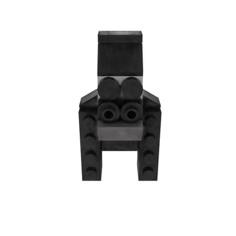
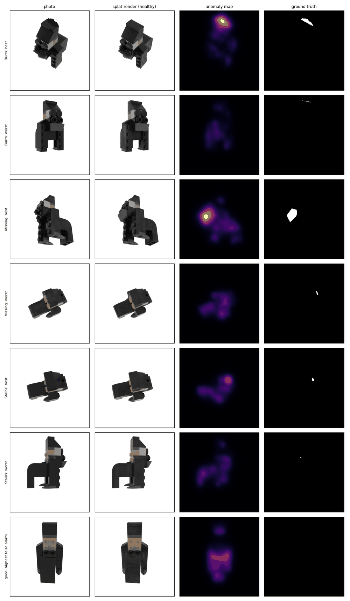
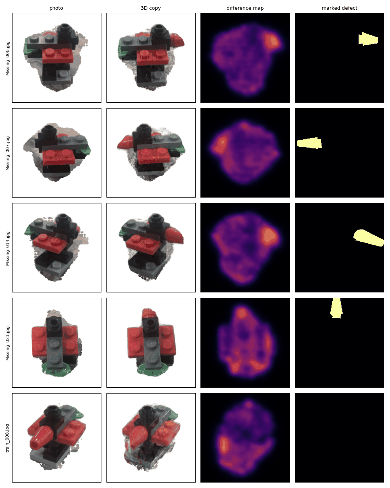

# Find what changed on an object, from any camera angle

Take photos of an object in good condition. Later, take a new photo from any angle: the system shows what is
different. It builds a 3D copy of the good object, draws it from the angle of the new photo, and compares the two.



**Status: work in progress.** Tested on a synthetic object and on two objects from a real-photo dataset. Next: photos of
my own object.

## How it works

1. **3D copy.** About 100 000 to 300 000 small 3D blobs ("Gaussians") are fitted to the photos of the good object
   (Gaussian Splatting). Each blob has a position, a size, an angle, a colour and a transparency.
2. **Camera position of a new photo.** Synthetic data: a matching network (LoFTR) finds the most similar training
   photo, then 175 small corrections line up the copy with the new photo. Real photos: COLMAP finds all camera
   positions together.
3. **Compare.** The photo and the drawing of the good object go through a pre-trained network (EfficientNet). Where
   its features differ, the map lights up. The image score is the highest value of the map.
4. **Real photos only: cut the object out.** The 3D copy also rebuilds the background, which adds noise. The object is
   cut out of every photo (SAM and U2-Net), the cut-outs are made consistent by carving the object in 3D from all
   photos, and the copy is trained on the object only.
5. **Several views.** Each pixel of each map is moved back onto the 3D object. A real defect stays at the same place
   in every view, a reflection does not. Views vote in a grid of small cubes.

AUROC is the chance that a photo with a defect scores higher than a good photo: 50 % is a coin flip, 100 % is perfect.

## What comes from others, what is mine

| From others | Mine |
|---|---|
| [3D Gaussian Splatting](https://arxiv.org/abs/2308.04079) (Inria): training and drawing | Setup on an RTX 5070 laptop (WSL, CUDA 12.8) and the two small fixes it needed |
| [SplatPose](https://arxiv.org/abs/2404.06832) ([code](https://github.com/m-kruse98/SplatPose)): camera position and comparison | Evaluation script with metrics and confidence ranges |
| [MAD / PAD](https://arxiv.org/abs/2310.07716): LEGO photos with the defect marked on each one | Multi-view fusion in 3D |
| LoFTR, EfficientNet, SAM, U2-Net, the AUPRO code from MVTec, [COLMAP](https://colmap.github.io/) | Chain for real photos: camera positions, object cut-out, scoring |

Finding defects from any angle has been done before ([SplatPose+](https://arxiv.org/abs/2410.12080); PIAD, CVPR 2025,
adds changing light; PCAD, WACV 2025 workshop, is a real-photo dataset). None of that is claimed here.

## Results

**Synthetic gorilla** (MAD-Sim, 259 test photos: 20 good, 239 with a defect), against the SplatPose paper (average of
20 objects):

| | This repo | Paper |
|---|---|---|
| Image AUROC | 93.7 % (95 % range: 89.2 to 96.9) | 93.9 % |
| Pixel AUROC | 99.6 % | 99.5 % |
| AUPRO | 94.8 % | 95.8 % |

Training the copy takes 6 min 22 s and 3.8 GB of GPU memory. One test photo takes 13.6 s.



**Real photos** (MAD-Real, a bear and a bird photographed by hand on a marble table). The bear is white on pale
marble, the bird is red, black and green. The defects are a black stain (bear) and a missing piece (bird).

| | Bear, whole scene | Bird, whole scene | Bird, object only |
|---|---|---|---|
| Photos with a defect / good photos | 24 / 11 | 22 / 12 | 22 / 12 |
| Training | 21 min 24 s | 13 min 37 s | 8 min 42 s |
| Image AUROC | 91.3 % (80.3 to 100) | 100 % | 96.6 % (89.8 to 100) |
| Pixel AUROC | 99.3 % | 99.1 % | 92.8 % |
| AUPRO | 97.1 % | 94.0 % | 73.2 % |

The pixel numbers of the last column cannot be compared with the others: with the whole scene the window is mostly
easy background, with the object only it is mostly the object. In the object-only copy the red tip of the bird is
rebuilt cleanly: it is in the copy, absent from the photo, and the map peaks there.



**Several views together**, image AUROC:

| | One view | Views combined | Gain (95 % range) |
|---|---|---|---|
| Gorilla, stains (synthetic) | 84.3 % | 92.4 % | +8.1 (+0.4 to +17.0) |
| Bear, object only (real) | 93.9 % | 100 % | +6.1 (0.0 to +16.7) |
| Bird, object only (real) | 96.6 % | 97.7 % | +1.1 (0.0 to +4.5) |

The gain is positive each time, but the ranges touch zero.

## Data and licenses

The data is not in this repository.

| Item | Source | License |
|---|---|---|
| MAD-Sim, MAD-Real | [PAD repository](https://github.com/EricLee0224/PAD) | CC BY-NC-SA 4.0 (non commercial) |
| Gaussian Splatting code (used by SplatPose) | `LICENSE.md` of SplatPose | Inria / MPII, research and evaluation only |
| Pre-trained weights (LoFTR, EfficientNet) | `model.zip` from the SplatPose README | not checked |
| pycolmap, COLMAP | [PyPI](https://pypi.org/project/pycolmap/) | BSD-3-Clause |
| SAM, `sam_vit_b` weights | [Meta](https://github.com/facebookresearch/segment-anything) | Apache 2.0 |
| rembg, U2-Net weights | [rembg](https://github.com/danielgatis/rembg) | MIT (code), Apache 2.0 (weights) |

This repository has no license file yet. The images in `results/` come from MAD and keep the CC BY-NC-SA 4.0 license,
with credit to its authors. Because the pipeline uses non-commercial parts, use the whole project for research and
learning only.

## Reproduce

Windows 11 with WSL2 (Ubuntu 22.04) and an NVIDIA driver for WSL. Download `MAD-Sim.zip` and `MAD-Real.zip` (links in
the PAD repository) into `~/data`.

```bash
scripts/setup_wsl.sh all                  # compiler, CUDA 12.8, Python environment
scripts/prepare_upstream.sh               # get SplatPose, apply the fixes, get the weights
scripts/build_extensions.sh               # build the GPU code for your card

# synthetic gorilla
scripts/prepare_mad_sim.sh 01Gorilla
python scripts/train_splat.py --classname 01Gorilla
python scripts/evaluate.py --classname 01Gorilla --tag full                # about 1 h of GPU
python scripts/evaluate.py --types good,Stains --tag stains_good           # about 13 min of GPU
python scripts/fusion_experiment.py --tag stains_good                      # one view against combined views
python scripts/render_turntable.py --up z                                  # the video above

# real photos, whole scene
python scripts/prepare_real.py --src ~/data/MAD-Real/Bird --out ~/data/real/Bird
python scripts/train_splat.py --real --classname Bird_real --iterations 20000 --source ~/data/real/Bird/train_scene --model-dir ~/data/real/Bird/splat
python scripts/real_check.py --work ~/data/real/Bird --classname Bird_real --iterations 20000
python scripts/real_detect.py --work ~/data/real/Bird --classname Bird_real
python scripts/real_fusion.py --work ~/data/real/Bird --classname Bird_real --iterations 20000

# real photos, object only (needs prepare_real.py first)
python scripts/segment_object.py --work ~/data/real/Bird
python scripts/train_splat.py --real --white --classname Bird_seg --iterations 20000 --source ~/data/real/Bird/seg_scene --model-dir ~/data/real/Bird/splat_seg
python scripts/real_check.py --work ~/data/real/Bird --classname Bird_seg --iterations 20000 --seg
python scripts/real_detect.py --work ~/data/real/Bird --classname Bird_seg --seg
python scripts/real_fusion.py --work ~/data/real/Bird --classname Bird_seg --iterations 20000 --seg
```

`scripts/extract_frames.py` picks the sharpest frames of a phone video, for photos of your own object.
