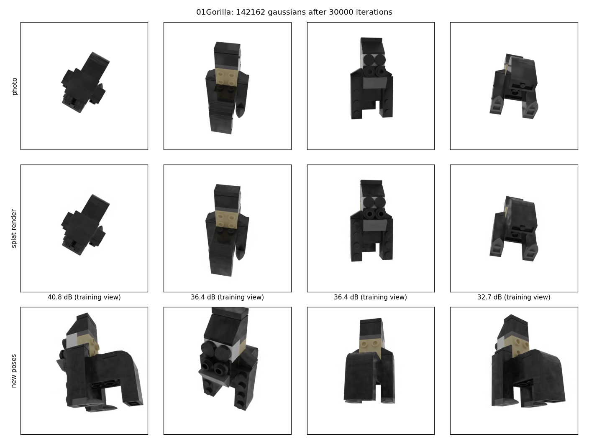

# Pose-agnostic defect detection with Gaussian Splatting

Detect what changed on an object between two captures, whatever the camera angle.
A 3D model of the healthy object is rebuilt from photos; for each new photo the model is rendered from the
same viewpoint and compared to it. The difference is the defect.


> **Status: work in progress.** Done: the existing method runs on my machine and is measured on one synthetic
> object. Not done yet: capture of a real object, multi-view fusion of the defect maps (the part that is mine).

## How it works

1. **Splat**: about 140 000 small 3D Gaussians are fitted on ~200 photos of the healthy object with known camera poses.
2. **Pose of a new photo**: LoFTR finds the most similar training photo (coarse pose), then 175 gradient steps
   adjust the pose until the rendered splat matches the photo.
3. **Compare**: EfficientNet features of the photo and of the render are subtracted into an anomaly map.
4. **Measure**: image AUROC, pixel AUROC and AUPRO against ground-truth masks.
   AUROC is the probability that a defective image (or pixel) scores higher than a good one; 50 % is chance.

## What comes from others, what is mine

| From others (not my work) | Mine |
|---|---|
| [3D Gaussian Splatting](https://arxiv.org/abs/2308.04079): training loop and CUDA rasterizer (Inria) | WSL / CUDA 12.8 setup for an RTX 5070 and the two fixes it needed ([`scripts/prepare_upstream.sh`](scripts/prepare_upstream.sh)) |
| [SplatPose](https://arxiv.org/abs/2404.06832) ([code](https://github.com/m-kruse98/SplatPose)): pose estimation and anomaly scoring | Evaluation script: chunked and resumable, metrics, bootstrap interval, figures ([`scripts/evaluate.py`](scripts/evaluate.py)) |
| [MAD / PAD dataset and benchmark](https://arxiv.org/abs/2310.07716) (LEGO objects, ground-truth masks) | Time and VRAM measurements, splat renders and turntable |
| LoFTR, EfficientNet, MVTec AUPRO code, [COLMAP](https://colmap.github.io/) | Frame selection and SfM tools for real captures ([`scripts/extract_frames.py`](scripts/extract_frames.py), [`scripts/run_sfm.py`](scripts/run_sfm.py)) |

Related work already covers pose-agnostic detection ([SplatPose+](https://arxiv.org/abs/2410.12080)),
illumination robustness (PIAD, CVPR 2025) and real-world data (PCAD, WACV 2025 workshop). None of that is claimed here.

## Results

One MAD-Sim object (01Gorilla), 259 test images (20 good, 239 with defects), one training seed.
Raw numbers: [`results/step1_01Gorilla_full.json`](results/step1_01Gorilla_full.json).

| Metric | This repo, 01Gorilla | SplatPose paper, mean of 20 objects |
|---|---|---|
| Image AUROC | 93.7 % (95 % bootstrap interval 89.2 to 96.9) | 93.9 % |
| Pixel AUROC | 99.6 % | 99.5 % |
| AUPRO | 94.8 % | 95.8 % |

Image AUROC by defect type: missing part 97.0 %, burr 91.6 %, stain 84.3 %.

| Cost on an RTX 5070 laptop GPU (8 GB) | |
|---|---|
| Splat training, 30 000 iterations | 6 min 22 s, 3.81 GB VRAM peak |
| Inference | 13.6 s per image (4.0 s of pose refinement) |




## Limits

- One object compared with a mean over 20 objects: the same order of magnitude, not a reproduction of the paper's table.
- Only 20 good images, hence the wide interval on the image AUROC.
- Small defects (burrs, stains of a few pixels) are often missed; 5 of the 239 lose their whole mask when shrunk to 224 px.
- Renders are clamped to [0, 1] before scoring (all of them exceeded 1 otherwise). The effect on the scores was not measured.
- Synthetic data only so far: nothing is claimed for photos taken with a phone.

## Data and licenses

Data are not in this repository.

| Item | Source | License |
|---|---|---|
| MAD-Sim | [PAD repository](https://github.com/EricLee0224/PAD) | CC BY-NC-SA 4.0 (non commercial) |
| Gaussian Splatting code (used by SplatPose) | SplatPose `LICENSE.md` | Inria / MPII, non commercial research and evaluation |
| pretrained weights (LoFTR, EfficientNet) | `model.zip` from the SplatPose README | not checked |
| pycolmap / COLMAP | [PyPI](https://pypi.org/project/pycolmap/) | BSD-3-Clause |

The scripts of this repository are MIT ([`LICENSE`](LICENSE)). The images in `results/` are derived from MAD-Sim and
stay under CC BY-NC-SA 4.0 with credit to its authors. Because the pipeline relies on non-commercial components,
treat the whole project as research and portfolio use only.

## Reproduce

Windows 11 + WSL2 Ubuntu 22.04, NVIDIA driver with WSL support. Download `MAD-Sim.zip` (link in the PAD repository) to `~/data`.

```bash
scripts/setup_wsl.sh all                  # compiler, CUDA 12.8, Python venv with PyTorch
scripts/prepare_upstream.sh               # clone SplatPose, apply fixes, fetch weights
scripts/build_extensions.sh               # compile the CUDA extensions for the GPU
scripts/prepare_mad_sim.sh 01Gorilla      # extract and convert one class
python scripts/train_splat.py --classname 01Gorilla
python scripts/evaluate.py --classname 01Gorilla --tag full     # about 1 h on the GPU
python scripts/render_turntable.py --up z                       # the video above
```

Capture protocol for the real-object part: [`docs/capture_protocol.md`](docs/capture_protocol.md).
