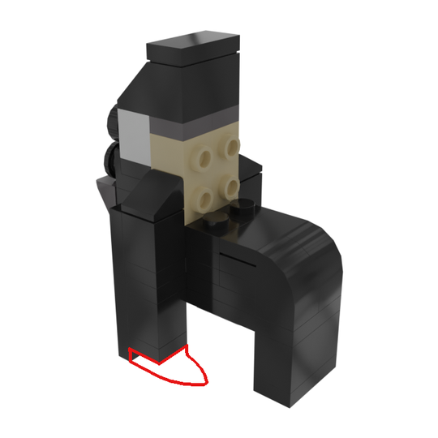
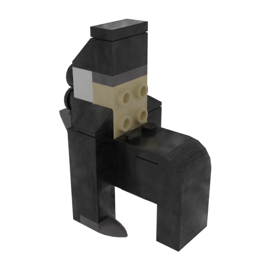
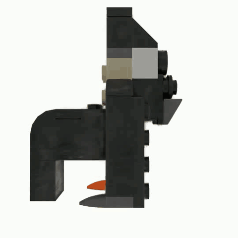
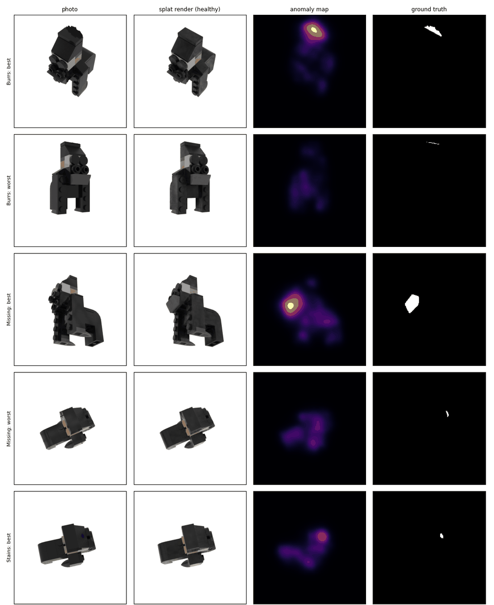
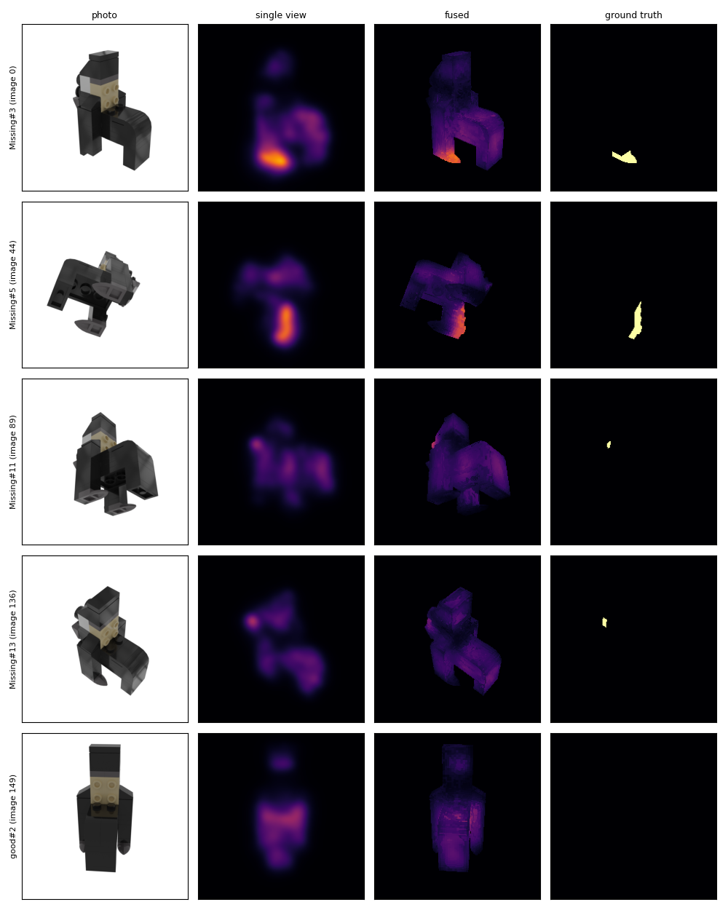
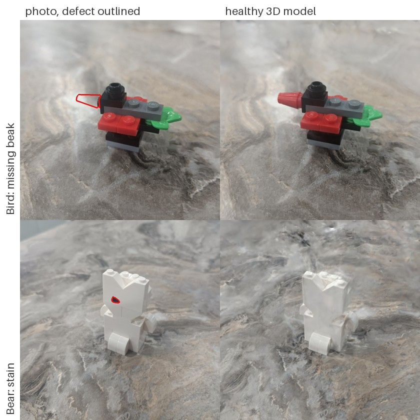

# Defect detection with 3D Gaussian Splatting

Finds defects on an object from photos taken at any angle. A 3D model of the defect-free object is drawn at the pose of
each photo and compared with it. Combining several photos of the same defect in 3D makes the detection more reliable and
shows where the defect sits on the object.

<table>
<tr>
<td align="center"><br><b>Photo with the defect</b><br>The red outline marks the missing plate.</td>
<td align="center"><br><b>Healthy 3D model</b><br>Same angle: the plate is there.</td>
<td align="center"><br><b>Defect found</b><br>Combining 25 photos in 3D.</td>
</tr>
</table>

LEGO gorilla from MAD-Sim with a missing plate under one foot.

## How it works

1. **Reference model.** A 3D Gaussian Splatting model is fitted to photos of the defect-free object.
2. **Pose and render.** For a test photo, LoFTR finds the closest training view, then the pose is refined by gradient
   descent through the renderer. The reference model is rendered at that pose. For real photos, COLMAP gives the poses
   instead.
3. **Anomaly map.** The photo and the render are compared pixel by pixel and with EfficientNet-b4 features. The result is
   a map, and the score of the photo is the highest value of its map.
4. **Fusion in 3D.** The map of one photo is noisy: reflections and small rendering errors light up the wrong places.
   A real defect stays at the same spot on the object, while those artefacts move with the camera. The depth of the 3D
   model tells where each pixel of a map lands on the object. Each photo adds its scores to a grid of small cubes around
   the object, and a cube is scored by the average over the photos that see it. The fused value is then read back in
   every photo.

Steps 1 to 3 follow SplatPose. Step 4 is the addition of this project.

## Results

All numbers are AUROC or AUPRO in percent. Image AUROC uses the highest value of the map as the score of a photo.
Ranges are 95 % bootstrap intervals.

### SplatPose on MAD-Sim (gorilla)

259 test photos: 20 good, 239 with a defect. SplatPose values are the averages over the 20 objects of the paper.

| | This repository | SplatPose |
|---|---|---|
| Image AUROC | 93.7 (89.2 to 96.9) | 93.9 |
| Pixel AUROC | 99.6 | 99.5 |
| AUPRO | 94.8 | 95.8 |



### Fusion of several photos (gorilla)

Two test sets: 137 photos with a missing piece, and 35 photos with a stain, each with the same 20 good photos. Photos of
the same defect are grouped by the position of the defect in 3D (taken from the ground-truth masks), and the good photos
are split into groups of 10. Each photo gets the fused value of its group. One photo alone and the fused version are
scored on the same photos and the same pixels (the object only, background excluded).

| | Image AUROC | Pixel AUROC |
|---|---|---|
| Missing piece, one photo | 97.1 | 98.3 |
| Missing piece, fused | 99.3 | 99.3 |
| Stain, one photo | 84.3 | 96.9 |
| Stain, fused | 92.4 | 97.6 |

The fusion raises the image AUROC by 2.2 points on missing pieces (0.5 to 4.4) and by 8.1 points on stains (0.4 to
17.0). With a stricter grouping of the photos (30 groups of missing pieces instead of 15) the gain is 2.4 points (0.7 to
4.6).

Image AUROC on missing pieces against the number of photos fused together:

| Photos | 1 | 2 | 4 | 8 | 16 |
|---|---|---|---|---|---|
| Image AUROC | 97.1 | 98.4 | 99.1 | 99.1 | 99.3 |

The first photos help the most and the curve flattens after about 4. AUPRO changes little (89.1 to 89.9 on missing
pieces, background set to 0): the fusion mainly improves which photos are flagged, not how much of the defect is
covered. Burrs (extra material) are left out: the healthy model has no surface there, so their pixels cannot be placed
in 3D.



On the turning model at the top, 9,334 gaussians glow clearly. 91 % of them lie on the defect as marked in the masks of
the same photos, and they cover 93 % of it. A fainter glow also runs up the leg.

### Real photos (MAD-Real)

Two objects photographed by hand on a marble table: a bear with a stain (24 photos) and a bird with a missing piece (22
photos). The good photos (11 and 12) are unseen good test photos plus training photos held out from the model. Pixel
metrics are computed on a window around the object.

| | Bear | Bird |
|---|---|---|
| Image AUROC | 91.3 (80.3 to 100) | 100 |
| Pixel AUROC | 99.3 | 99.1 |
| AUPRO | 97.1 | 94.0 |

<p align="center"></p>

*Full photos, not zoomed. Left: a real photo with the defect as marked in the dataset (red outline). Right: the healthy
3D model drawn from the same camera.*

## Conclusion

The reference-rendering approach of SplatPose is reproduced on the gorilla, with an image AUROC of 93.7 % against
93.9 % averaged over 20 objects in the paper. Fusing the maps of several photos in 3D raises the image AUROC from 97.1 %
to 99.3 % on missing pieces and from 84.3 % to 92.4 % on stains, and it shows where the defect is on the object. With
camera poses from COLMAP in place of the pose search, the detection also works on real photos: 91.3 % (bear, stain) and
100 % (bird, missing piece).

## Reproduction

Linux or WSL2 with an NVIDIA GPU and CUDA 12.8. `MAD-Sim.zip` and `MAD-Real.zip` (links in the PAD repository) go in
`~/data`.

```bash
scripts/setup_wsl.sh all && scripts/prepare_upstream.sh && scripts/build_extensions.sh

# SplatPose on the gorilla
scripts/prepare_mad_sim.sh 01Gorilla
python scripts/train_splat.py --classname 01Gorilla
python scripts/evaluate.py --classname 01Gorilla --tag full

# fusion (missing pieces; use --types good,Stains --tag stains_good for stains) and the 3D animations
python scripts/evaluate.py --classname 01Gorilla --types good,Missing --tag missing_good
python scripts/fusion_experiment.py --tag missing_good --sweep
python scripts/defect_3d.py --photo 000.png

# real photos
python scripts/prepare_real.py --src ~/data/MAD-Real/Bird --out ~/data/real/Bird
python scripts/train_splat.py --real --classname Bird_real --iterations 20000 --source ~/data/real/Bird/train_scene --model-dir ~/data/real/Bird/splat
python scripts/real_check.py --work ~/data/real/Bird --classname Bird_real --iterations 20000
python scripts/real_detect.py --work ~/data/real/Bird --classname Bird_real
python scripts/real_figure.py Bird:Missing_006.jpg Bear:Stains_010.jpg   # needs the same steps for the bear
```

`defect_3d.py` writes the two images and an MP4 video; the GIF above is the same video with fewer colours.

## Data and licenses

Data is not redistributed. The images in `results/` derive from MAD and keep the CC BY-NC-SA 4.0 license. The pipeline
relies on non-commercial components: research use only. This repository has no license file yet.

| Item | License |
|---|---|
| MAD-Sim, MAD-Real ([PAD repository](https://github.com/EricLee0224/PAD)) | CC BY-NC-SA 4.0 |
| 3D Gaussian Splatting code (Inria / MPII), used through SplatPose | research and evaluation only |
| LoFTR and EfficientNet weights (`model.zip` from the SplatPose README) | not checked |
| COLMAP / pycolmap | BSD-3-Clause |

## References

- Kerbl et al., [3D Gaussian Splatting for Real-Time Radiance Field Rendering](https://arxiv.org/abs/2308.04079), SIGGRAPH 2023.
- [SplatPose](https://arxiv.org/abs/2404.06832) and [SplatPose+](https://arxiv.org/abs/2410.12080); [code](https://github.com/m-kruse98/SplatPose).
- [MAD / PAD dataset and benchmark](https://arxiv.org/abs/2310.07716), NeurIPS 2023.
- Sun et al., [LoFTR](https://arxiv.org/abs/2104.00680), CVPR 2021.
- Tan and Le, [EfficientNet](https://arxiv.org/abs/1905.11946), ICML 2019.
- Schönberger and Frahm, Structure-from-Motion Revisited, CVPR 2016 ([COLMAP](https://colmap.github.io/)).
